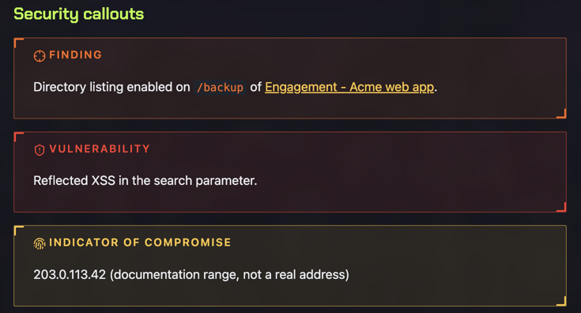
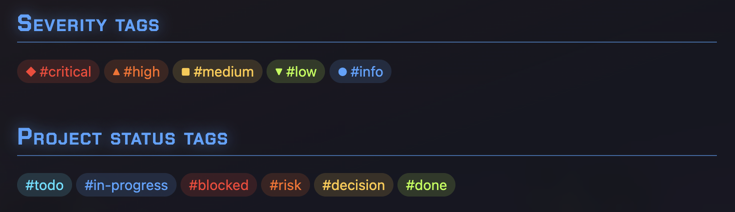
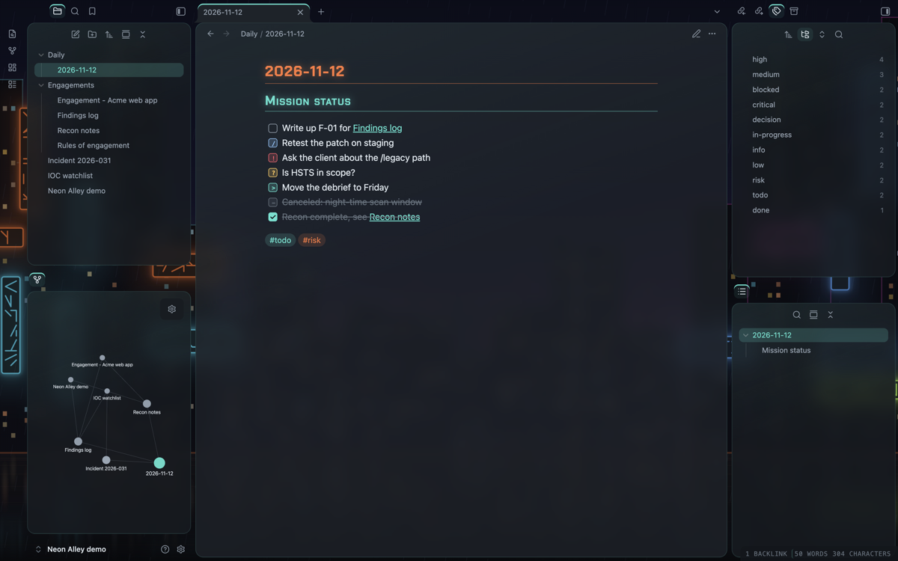

# Neon Alley


An Obsidian theme that looks like a city street at night: dark asphalt,
traffic-cone orange and a row of neon signs. It has HUD-style callouts
for security work, color-coded severity tags and a retro, framed
layout with buttons that press in.

## How this was made

I designed and directed this theme. The CSS, the tools and this README
were generated with Claude (Anthropic's AI) through many rounds of my
feedback, and the theme was checked against screenshots of Obsidian at
each step.

Read how it was designed, tested and released in the
[Neon Alley write-up](https://github.com/james-s-pearson/Cybersecurity-Portfolio/tree/main/released-software/neon-alley-theme).

## Looks

Choose these in the Style Settings or Style Manager plugin.

**Palettes** (each has a dark and a light version):

- **Neon Alley**: asphalt with cone orange, signage blue, acid lime,
  amber and cyan. Links are amber, bold text neon red, italics wet
  teal and bold italics neon fuchsia.
- **Sodium Rain**: the same street after rain, with wet teal, gold and
  brake-light red.
- **Cold Forge**: slate with aqua and forge orange.
- **Polar Ember**: slate with ice blue and forge orange.

**Structures:**

- **Glass**: rounded panes with a faint sheen.
- **Retro**: each pane split into a framed header (orange) and a framed
  content area (cyan, with a faint glow), with 3D buttons that press
  in when clicked.

**Callout styles:**

- **HUD**: corner brackets and spaced capitals.
- **Glass**: a soft glow with a colored left edge.

**Backdrop and wallpaper:** behind the panes sits one of six built-in
wallpapers drawn for this theme: Neon skyline (a rainy city at night),
Rain alley (neon signs down a wet alley), Sodium street (a road under
orange street lamps), Rail line (an elevated train in green neon),
Harbor (cranes over ice-blue water) or Tunnel (a road tunnel of red
brake lights). You can dim it, turn it off, or use your own image
(paste `url("https://…")`). A web link is loaded by Obsidian when you
choose it; the theme itself loads nothing from the internet.

Turn on Obsidian's **Translucent window** setting (Settings → Appearance)
and the panes become see-through, with the wallpaper blurred behind your
notes; adjust the opacity and blur in the theme's options.


## Customize

With Style Settings (or Style Manager), the **Colors** section lets you
change any of these, with a separate value for dark and light mode:

- the accent color, or Obsidian's own accent color
- the six neon colors that most of the theme is built from
- bold, italic and bold italic text
- each heading level, links, the default tag color and the severity
  tags
- code colors (the Treelights plugin's "Follow Obsidian theme" option
  uses them too)
- each callout type and the Retro frames
- text and background shades (advanced)

Leave a color empty to keep the palette's own. The contrast check below
covers the built-in palettes only, so check that your own colors stay
readable.

Other options: the body font for headings, normal-case headings instead
of small capitals, glow strength (0 turns the glow off) and sharp or
rounded corners.

## Features

### Security callouts



Use these like any Obsidian callout, for example `> [!vuln]`:

- `[!finding]`: a finding
- `[!vuln]`: a vulnerability
- `[!ioc]`: an indicator of compromise
- `[!recon]`: reconnaissance notes
- `[!cmd]`: a command (shown in monospace)
- `[!flag]`: blurred until you hover over it, so flags and secrets stay
  hidden in screenshots

### Project callouts

- `[!risk]`, `[!decision]`, `[!blocker]`, `[!action]` and `[!done]`

### Severity and status tags



Severity tags get a color and a shape, so the level reads without
relying on color alone:

- `#critical`: red, ◆
- `#high`: orange, ▲
- `#medium`: amber, ■
- `#low`: green, ▼
- `#info`: blue, ●

Project status tags get their own colors: `#todo`, `#in-progress`,
`#blocked`, `#risk`, `#decision` and `#done`.

### Mission-status tasks



- `- [/]` in progress
- `- [!]` urgent
- `- [?]` question
- `- [>]` deferred
- `- [-]` canceled

### Other details

- Headings in Chakra Petch, with small capitals and a soft glow on the
  note title and the first two heading levels, and a fine underline
  under H1 and H2
- Code in Tokyo Night colors, the default color scheme of LazyVim
  (moon in dark mode, day in light mode). Obsidian's own highlighters
  know fewer kinds of token than Neovim, so a few kinds share a color
  (for example, every keyword is pink)
- A HUD-style status bar
- Graph view and Canvas colors that follow the palette
- Mermaid diagrams in the theme's colors, with neon outlines and a soft
  glow
- Styling for the Calendar, Kanban, Tasks (overdue dates in red, due
  today in amber) and File Explorer Note Count plugins
- Optional prompt-style headings (`❯`), CRT scanlines, flat panes,
  plain frames, flat buttons and a glass sheen for Retro

## Accessibility

Every text color meets WCAG contrast targets in all eight palette and
mode combinations: 7:1 for body text, 4.5:1 for colored text and 3:1
for faint text. Run the check yourself with:

```sh
python3 tools/contrast.py src/theme.src.css
```

Hover effects are turned off when your system asks for reduced motion.

## Install

1. In Obsidian, open **Settings → Appearance → Themes → Manage**.
2. Search for **Neon Alley** and choose **Install and use**.
3. For the options, install the **Style Settings** plugin (or Style
   Manager) and open its **Neon Alley** section.

To install it by hand instead, create a folder called `Neon Alley` in
your vault's `.obsidian/themes` folder, copy `manifest.json` and
`theme.css` into it, then choose **Neon Alley** in **Settings →
Appearance → Themes**.

## Working with other plugins

- **Colored Tags**: this plugin colors every tag. Neon Alley overrides
  it for the severity and status tags only, so the rest of your tags
  keep their plugin colors (and Neon Alley's default tag color applies
  only with Colored Tags off).
- **Excalidraw**: it styles its own toolbar and menus (its Dynamic
  styling setting), so Neon Alley leaves them alone. Use Excalidraw's
  own settings to match dark drawings to Obsidian's theme.
- **Code Block Customizer**: set its theme to **Obsidian** so code
  blocks and inline code follow Neon Alley's colors. Its other themes
  use fixed colors of their own.
- **Shiki Highlighter**: this plugin colors code with its own theme,
  in both editing and Reading view, and overrides Neon Alley's code
  colors. Choose its **Obsidian Theme** to use Neon Alley's colors,
  or a Tokyo Night theme of your own.

## Build from source

The theme is written in `src/theme.src.css`. The build script adds the
fonts and the wallpapers and writes `theme.css`:

```sh
./build.sh
```

The embedded fonts are a subset of the full Chakra Petch files in
`src/fonts/full/`, made by `tools/subset-fonts.sh` (it needs
`fonttools`). The wallpapers are drawn by `tools/skyline.py` and
`tools/scenes.py`.

## Credits

- Chakra Petch by the Chakra Petch Project Authors, embedded under the
  SIL Open Font License 1.1 (see `OFL.txt`).
- The Retro structure was inspired by the Retroma theme by emarpiee.
  Neon Alley shares no code with it.
- Code colors follow Tokyo Night as set up in tokyonight.nvim by Folke
  Lemaitre (Apache License 2.0), the default color scheme of LazyVim.
- The wallpapers were drawn for this theme by `tools/skyline.py` and
  `tools/scenes.py`.

## License

Neon Alley is released under the MIT License (see `LICENSE`). The
embedded Chakra Petch font keeps its own SIL Open Font License 1.1
(see `OFL.txt`).
