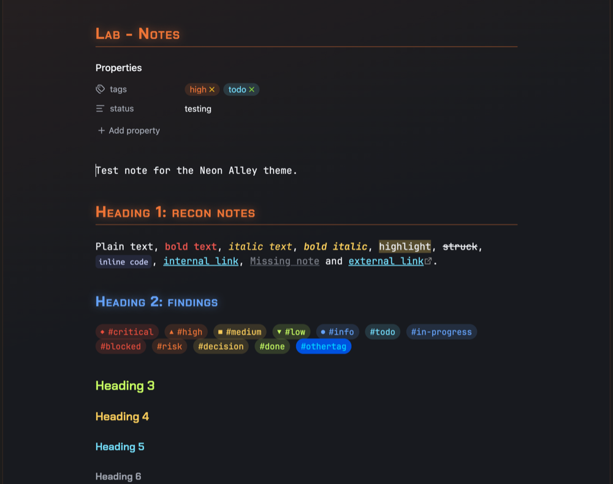
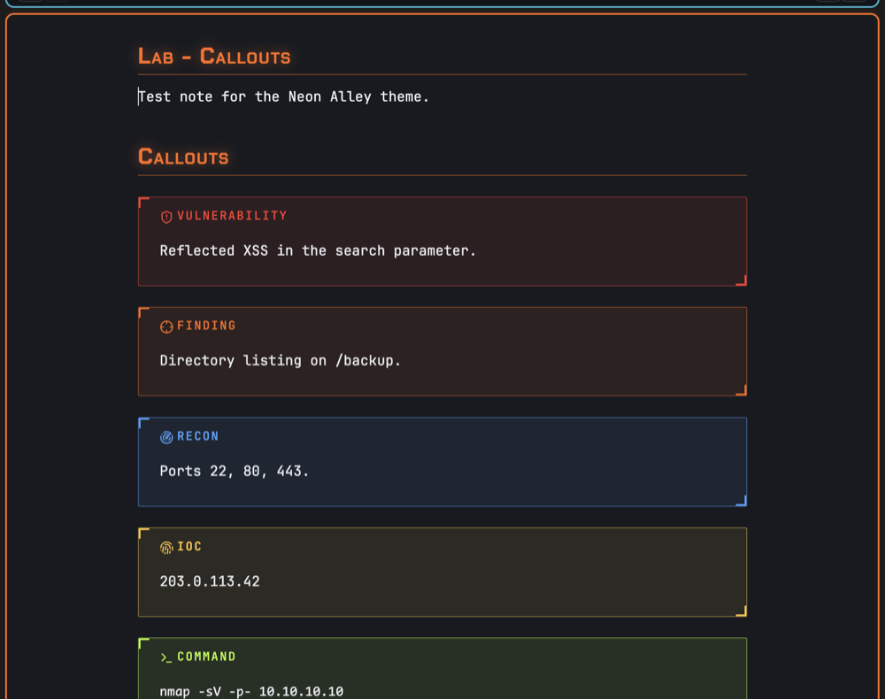
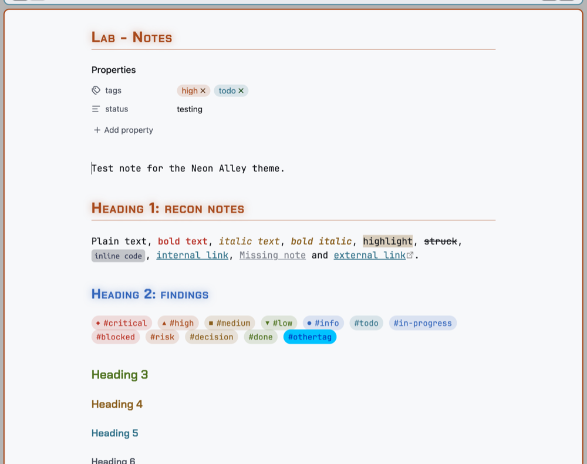
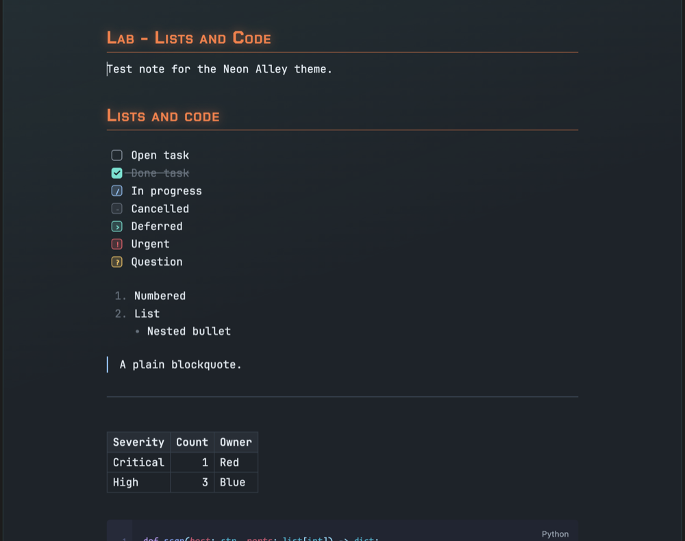

# Neon Alley

An Obsidian theme that looks like a city street at night: dark asphalt,
traffic-cone orange and a row of neon signs. It has HUD-style callouts
for security work, colour-coded severity tags and a retro, framed
layout with buttons that press in.



## How this was made

I designed and directed this theme. The CSS, the tools and this README
were generated with Claude (Anthropic's AI) through many rounds of my
feedback, and the theme was checked against screenshots of Obsidian at
each step.

## Looks

Choose these in the Style Settings or Style Manager plugin.

**Palettes** (each has a dark and a light version):

- **Neon Alley**: asphalt with cone orange, signage blue, acid lime,
  amber and cyan. Links are amber, bold text neon red, italics wet
  teal and bold italics neon fuchsia.
- **Sodium Rain**: the same street after rain, with wet teal, gold and
  brake-light red.
- **Cold Forge**: slate with aqua and forge orange.
- **Polar Ember**: slate with ice blue and forge orange.

**Structures:**

- **Glass**: rounded panes with a faint sheen.
- **Retro**: each pane split into a framed header (orange) and a framed
  content area (cyan, with a faint glow), with 3D buttons that press
  in when clicked.

**Callout styles:**

- **HUD**: corner brackets and spaced capitals.
- **Glass**: a soft glow with a coloured left edge.

**Backdrop and wallpaper:** behind the panes sits one of three built-in
wallpapers drawn for this theme: Neon skyline (a rainy city at night),
Rain alley (neon signs down a wet alley) or Sodium street (a road under
orange street lamps). You can dim it, turn it off, or use your own image
(paste `url("https://…")`). A web link is loaded by Obsidian when you
choose it; the theme itself loads nothing from the internet.

Turn on Obsidian's **Translucent window** setting (Settings → Appearance)
and the panes become see-through, with the wallpaper blurred behind your
notes; adjust the opacity and blur in the theme's options.





## Features

### Security callouts

Use these like any Obsidian callout, for example `> [!vuln]`:

- `[!finding]`: a finding
- `[!vuln]`: a vulnerability
- `[!ioc]`: an indicator of compromise
- `[!recon]`: reconnaissance notes
- `[!cmd]`: a command (shown in monospace)
- `[!flag]`: blurred until you hover over it, so flags and secrets stay
  hidden in screenshots

### Project callouts

- `[!risk]`, `[!decision]`, `[!blocker]`, `[!action]` and `[!done]`

### Severity and status tags

Severity tags get a colour and a shape, so the level reads without
relying on colour alone:

- `#critical`: red, ◆
- `#high`: orange, ▲
- `#medium`: amber, ■
- `#low`: green, ▼
- `#info`: blue, ●

Project status tags get their own colours: `#todo`, `#in-progress`,
`#blocked`, `#risk`, `#decision` and `#done`.

### Mission-status tasks



- `- [/]` in progress
- `- [!]` urgent
- `- [?]` question
- `- [>]` deferred
- `- [-]` cancelled

### Other details

- Headings in Chakra Petch, with small capitals and a soft glow on the
  note title and the first two heading levels, and a fine underline
  under H1 and H2
- Code in Tokyo Night colours, the default colour scheme of LazyVim
  (moon in dark mode, day in light mode). Obsidian's own highlighters
  know fewer kinds of token than Neovim, so a few kinds share a colour
  (for example, every keyword is pink)
- A HUD-style status bar
- Graph view and Canvas colours that follow the palette
- Styling for the Calendar and Kanban plugins
- Optional prompt-style headings (`❯`), CRT scanlines, flat panes,
  plain frames, flat buttons and a glass sheen for Retro

## Accessibility

Every text colour meets WCAG contrast targets in all eight palette and
mode combinations: 7:1 for body text, 4.5:1 for coloured text and 3:1
for faint text. Run the check yourself with:

```sh
python3 tools/contrast.py src/theme.src.css
```

Hover effects are turned off when your system asks for reduced motion.

## Install

Neon Alley is not in Obsidian's community theme list yet. To install it
by hand:

1. In your vault, open the `.obsidian/themes` folder and create a folder
   called `Neon Alley`.
2. Copy `manifest.json` and `theme.css` into it.
3. In Obsidian, open **Settings → Appearance → Themes** and choose
   **Neon Alley**. Restart Obsidian if it is not listed.
4. For the options, install the **Style Settings** plugin (or Style
   Manager) and open its **Neon Alley** section.

## Working with other plugins

- **Colored Tags**: this plugin colours every tag. Neon Alley overrides
  it for the severity and status tags only, so the rest of your tags
  keep their plugin colours.
- **Code Block Customizer**: set its theme to **Obsidian** so code
  blocks and inline code follow Neon Alley's colours. Its other themes
  use fixed colours of their own.
- **Shiki Highlighter**: this plugin colours code with its own theme,
  in both editing and Reading view, and overrides Neon Alley's code
  colours. Choose its **Obsidian Theme** to use Neon Alley's colours,
  or a Tokyo Night theme of your own.

## Build from source

The theme is written in `src/theme.src.css`. The build script adds the
fonts and writes `theme.css`:

```sh
./build.sh
```

## Credits

- Chakra Petch by the Chakra Petch Project Authors, embedded under the
  SIL Open Font License 1.1 (see `OFL.txt`).
- The Retro structure was inspired by the Retroma theme by emarpiee.
  Neon Alley shares no code with it.
- Code colours follow Tokyo Night as set up in tokyonight.nvim by Folke
  Lemaitre (Apache License 2.0), the default colour scheme of LazyVim.
- The wallpapers were drawn for this theme by `tools/skyline.py` and
  `tools/scenes.py`.

## Licence

Neon Alley is released under the MIT Licence (see `LICENSE`). The
embedded Chakra Petch font keeps its own SIL Open Font License 1.1
(see `OFL.txt`).
